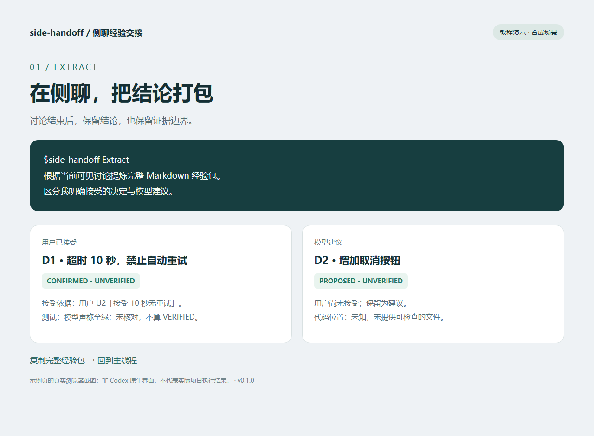
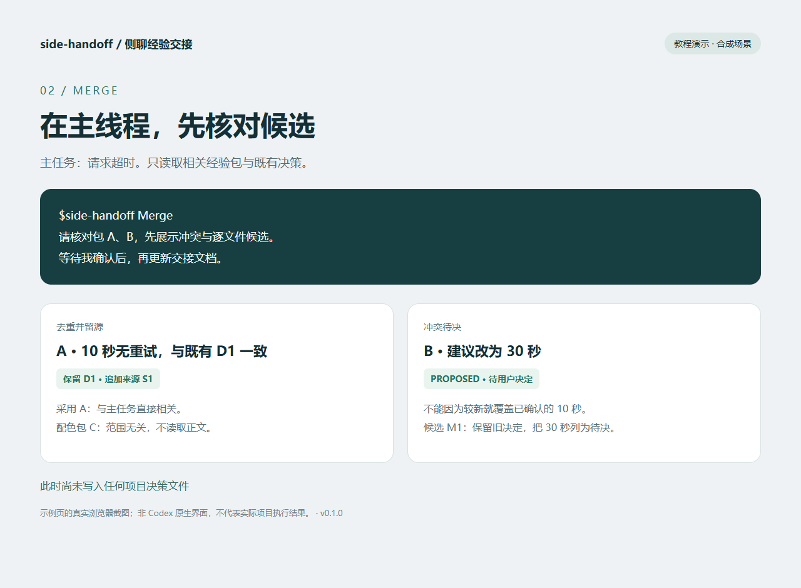
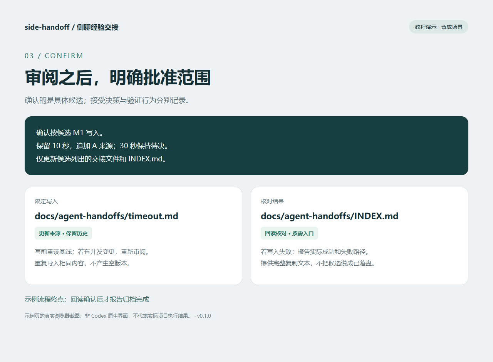

# side-handoff

把多轮侧聊打磨出的方案提炼成经验包，让主线程按需吸收决策、理由和证据。

**Extract → 复制经验包 → Merge 候选 → 用户确认 → 项目决策文件**

这是一个 Codex Skill，不是自动合并聊天记录的插件。它不扫描聊天数据库，也不假定能读取其他线程。

## 三分钟上手

### 1. 在侧聊提炼

讨论完成后，在该侧聊发送：

```text
$side-handoff Extract
请根据当前可见讨论提炼最终经验包，区分我明确接受的决定与模型建议。
保留设计理由、约束、否决方案、待验证假设、代码位置和验收标准。
直接输出完整 Markdown，方便我复制到主线程。
```



### 2. 在主线程核对

复制生成的 Markdown，回到主线程发送：

```text
$side-handoff Merge
主任务：完成请求超时处理。
项目根目录：请使用当前项目的真实根目录。
下面粘贴两个侧聊经验包，请按主任务相关性选择，核对现有代码与既有决策。
先展示去重结果、冲突和逐文件候选变更，等待我确认后再写文件。
默认不改产品代码。

[在这里粘贴经验包 A 和 B 的完整 Markdown]
```



### 3. 审阅并确认

确认候选里的目标路径、冲突选择和内容后，回复具体范围，例如：

```text
确认按候选 M1 写入：保留 10 秒无重试，追加 A 的来源；30 秒建议保持待决。
仅更新候选列出的 docs/agent-handoffs/ 决策文件与 INDEX.md。
```

确认前不写入项目决策文件。确认归档不等于接受所有建议，也不等于测试通过。



以上为合成教程示例页的浏览器截图，不是 Codex 原生界面截图，也不证明真实项目已合并。

## 安装

本机已安装在 `~/.codex/skills/side-handoff`。若当前聊天已列出 `side-handoff`，可直接使用。

其他机器：克隆本仓库到独立目录，再复制 Skill 核心文件。以下 PowerShell 命令遇到已有安装会停止，避免覆盖：

```powershell
git clone https://github.com/tianxiangliu-ds/side-handoff.git
$target = Join-Path $HOME '.codex/skills/side-handoff'
if (Test-Path -LiteralPath $target) { throw '已有安装，请先比较版本并备份，停止覆盖。' }
New-Item -ItemType Directory -Path $target -ErrorAction Stop | Out-Null
Copy-Item -LiteralPath './side-handoff/SKILL.md' -Destination $target
Copy-Item -LiteralPath './side-handoff/references' -Destination $target -Recurse
```

如果新会话仍未发现 Skill，可直接指定实际 `SKILL.md` 路径并要求读取使用；不要因此授予额外文件权限。Codex 的发现机制可能随客户端变化，参见 [OpenAI 官方 Skills 文档](https://developers.openai.com/codex/skills/)。本仓库教程以已安装的本地 Skill 为准。

## 继续阅读

- [完整中文教程：多侧聊、增量、权限降级](docs/tutorial.zh-CN.md)
- [Skill 指令](SKILL.md) 与 [经验包格式](references/package.md)
- [Merge 确认流程](references/merge.md)
- [可测试用例](references/examples.md) 与 [验证范围](docs/validation.md)
- [维护与贡献](CONTRIBUTING.md)、[版本记录](CHANGELOG.md)

## 状态速查

| 维度 | 状态 | 解释 |
| --- | --- | --- |
| 用户接受 | CONFIRMED / PROPOSED | 明确接受 / 仍是建议或接受未知 |
| 验证证据 | VERIFIED / UNVERIFIED | 有限定范围的可检查证据 / 尚未核实 |
| 历史替代 | SUPERSEDED | 已被替代，保留原因和后继 ID |

例如：你同意某方案，但没有跑测试，它应是 `CONFIRMED + UNVERIFIED`。

当前发布：**v0.1.0**。自动检查验证文件结构和链接；模型行为仍需按测试用例演练。
